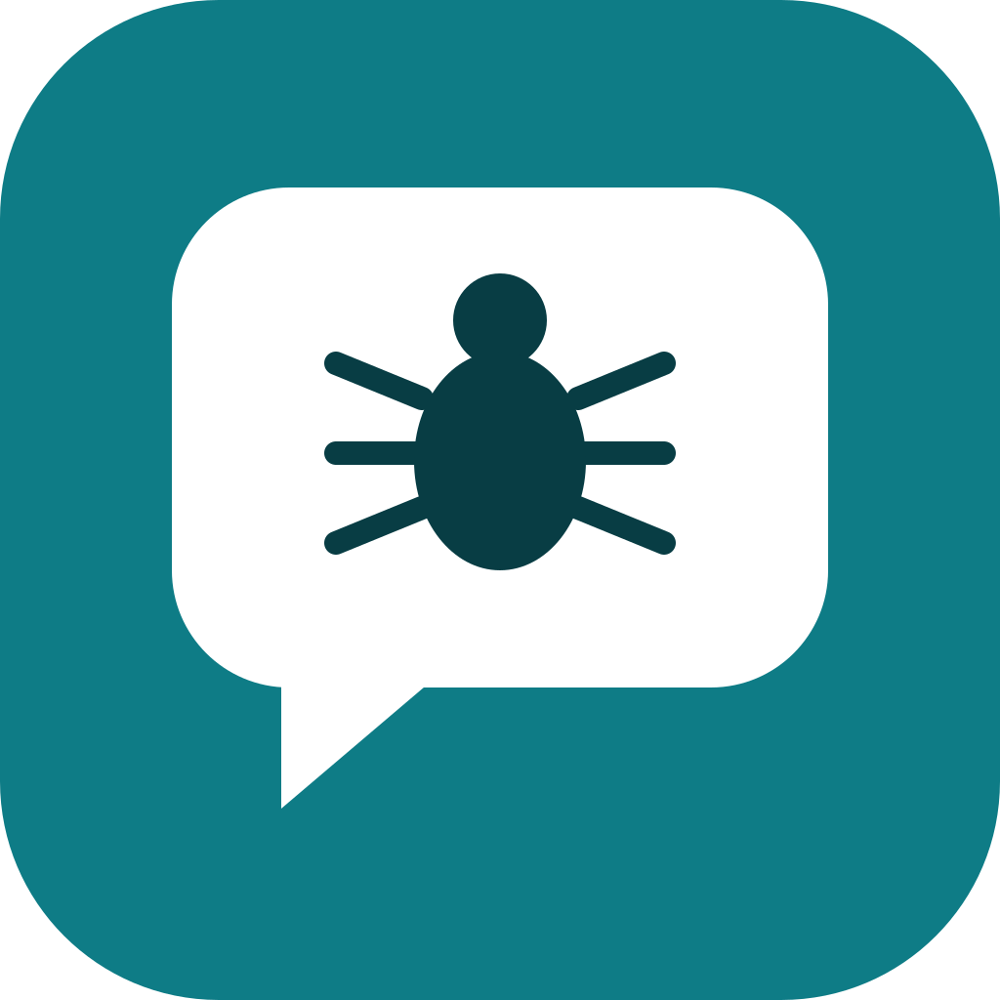

# ClarityFeedbackKit



A tiny Swift Package: embed it in an app so its users can send a bug report
or idea straight to you, as a real GitHub Issue — which then gets pulled
into Clarity automatically by its GitHub importer.

```
Your app + ClarityFeedbackKit  →  clarity-feedback-relay  →  GitHub Issues  →  Clarity
        (this package)              (the relay repo)
```

The SDK never talks to GitHub directly and never holds a GitHub credential —
it POSTs to a relay you control, using a per-app **ingest token** (like a
Sentry DSN). See `clarity-feedback-relay`'s README for how to issue tokens.

<br clear="left">

## Requirements

macOS 26+ / iOS 26+, Swift 6.2+.

## Installation

Add it by URL (in Xcode: File › Add Package Dependencies…, or in a
`Package.swift`):

```swift
.package(url: "https://github.com/pdarcey/ClarityFeedbackKit", from: "1.0.0")
```

Then add the `ClarityFeedbackKit` library product to your **app** target.

Prefer the URL form over a local path for anything you commit: a
`.package(path: "../ClarityFeedbackKit")` dependency only resolves on a
machine with the same folder layout, so it breaks CI (including Xcode Cloud).
A local path is still handy for developing the package itself alongside a
host app.

## Usage

Configure once, early in app launch (e.g. in your `App`'s `init()`):

```swift
import ClarityFeedbackKit

ClarityFeedback.configure(
    ingestURL: URL(string: "https://clarity-feedback-relay.<your-subdomain>.workers.dev/v1/feedback")!,
    appToken: "<this app's ingest token>"
)
```

`configure` is synchronous and thread-safe, so it's fine to call from an
`App`'s `init()` (which isn't main-actor-isolated) or anywhere else. The
configuration is only read when a report is submitted, and calling
`configure` again replaces the previous values.

Then present the ready-made form from anywhere. `ReportIssueView` closes itself
(Cancel/Done) using whatever dismissal mechanism matches how it's presented, so
present it the idiomatic way for each platform rather than a single `.sheet`
everywhere — a sheet reads as a modal interruption on macOS, where a
self-contained form like this is normally its own window:

```swift
// iOS/iPadOS — a sheet is the right call here.
.sheet(isPresented: $showingReportSheet) {
    ReportIssueView()
}
```

```swift
// macOS — give it its own Window scene instead of a sheet...
Window("Report a Bug", id: "report-issue") {
    ReportIssueView()
}

// ...and open it with:
@Environment(\.openWindow) private var openWindow
// ...
openWindow(id: "report-issue")
```

On macOS, the form's Cancel and Done buttons close it with `dismissWindow()`,
which is made for a window scene, not a sheet. Present it in its own `Window`
as shown above. On iOS they use `dismiss()`, which is what closes a sheet.

That's the entire public API: `ClarityFeedback.configure(ingestURL:appToken:)`,
`ClarityFeedback.isConfigured`, and `ReportIssueView`.

### Handling the ingest token

You need two values from whoever runs the relay:

| Value | What it is | Secret? |
|---|---|---|
| `ingestURL` | The relay's `/v1/feedback` endpoint | No — fine to keep in source |
| `appToken` | This app's ingest token, issued once per app | Yes — keep it out of source control |

`appToken` is scoped to creating issues on one repo, but it's still a
credential — don't commit it as a string literal the way the example above
shows for brevity. Anything committed to source ends up in your git history,
which matters if the repo is ever shared or made public.

Pull it in at build time instead, e.g. via an `.xcconfig` (kept out of source
control) that sets a build setting, which an `Info.plist` key then
references (`ClarityFeedbackAppToken` = `$(CLARITY_FEEDBACK_APP_TOKEN)`).
Read it back at launch:

```swift
init() {
    let ingestURL = URL(string: "https://clarity-feedback-relay.<your-subdomain>.workers.dev/v1/feedback")!
    if let appToken = Bundle.main.object(forInfoDictionaryKey: "ClarityFeedbackAppToken") as? String,
       !appToken.isEmpty {
        ClarityFeedback.configure(ingestURL: ingestURL, appToken: appToken)
    }
}
```

If the token is missing (say, a contributor's build without the
`.xcconfig`), skip `configure` rather than crashing, and use
`ClarityFeedback.isConfigured` to hide your "Report a Bug" entry point:

```swift
if ClarityFeedback.isConfigured {
    Button("Report a Bug…", systemImage: "ladybug") { openWindow(id: "report-issue") }
}
```

This matters because `ReportIssueView` doesn't check configuration itself.
An unconfigured submission fails with a developer-facing error message that
your end users would see.

Any equivalent scheme works just as well (a CI-injected build setting, for
example). The point is to keep the token out of source and out of git history,
the same way you'd handle a Sentry DSN.
Build-time injection does **not** hide the token from the shipped app,
though: it still ends up in the app bundle, and a determined user can extract
it. That's acceptable only because the token can do so little (create issues
on one repo) and the relay can revoke it per app. Never put anything more
powerful, such as a GitHub PAT, in a host app.

## What it does

`ReportIssueView` is a title + description form. On submit, it POSTs
`{title, body, appVersion, osVersion, deviceModel}` to the configured relay
URL with `Authorization: Bearer <appToken>`, then shows either a simple
"Thanks for the report!" confirmation, or an inline error with the option
to retry (there's no automatic retry or offline queue in v1 — if the POST
fails, the user sees why and can try again).

That inline error is shown to the user word for word. That includes the
relay's own `error` string when it rejects a submission. So whoever runs the
relay should make its error messages suitable for end users, and never pass
a raw GitHub API error through.

The confirmation deliberately doesn't link to the created GitHub issue —
that repo is your internal plumbing (and may be private), not something your
users should see. The issue's URL is logged via `OSLog` instead (subsystem
`com.xerodonia.ClarityFeedbackKit`, category `ReportIssueView`), so you can
still trace a report while developing.

`appVersion`/`osVersion`/`deviceModel` are gathered automatically —
`deviceModel` via `uname(2)` (a raw hardware identifier like `"iPhone15,3"`,
not a friendly name), so the package never imports UIKit.

## What it deliberately doesn't do (v1)

- **No screenshot/attachment support.** GitHub's Issues REST API has no
  first-party attachment endpoint; solving that cleanly needs blob storage
  (e.g. R2) on the relay. Deliberate v1 cut, not an oversight.
- **No local persistence or retry queue.** A failed submission just shows an
  inline error; the user re-submits manually.
- **No write-back.** This is GitHub → Clarity only, for now — closing the
  GitHub issue when the Clarity issue is marked complete is a possible
  future addition, not built yet.

## Testing

```bash
swift test
```

Uses Swift Testing with an injected `URLRequestPerforming` stub — no real
network access or relay needed to run the suite.
